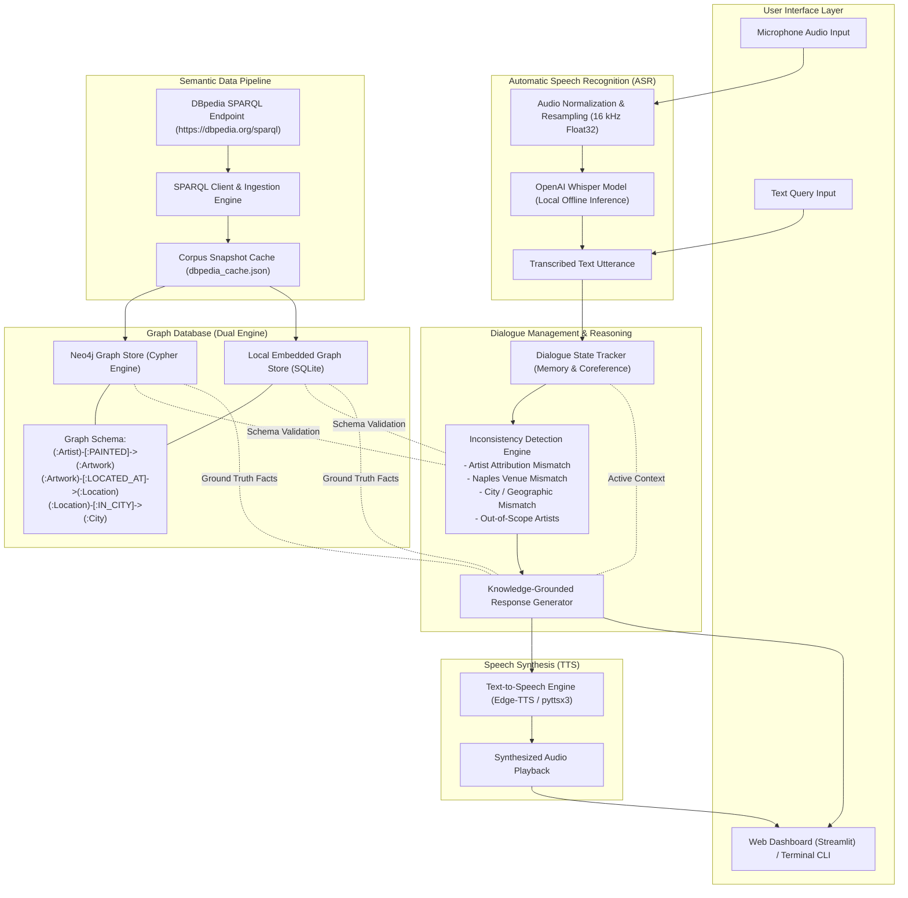

# Neapolitan Artistic Heritage Speech Dialogue System
### Caravaggio & Battistello Caracciolo in Naples, Italy

An intelligent, speech-enabled conversational agent acting as an authoritative cultural guide for Neapolitan artistic heritage. The system enables voice and text inquiries concerning masterpieces by **Michelangelo Merisi da Caravaggio** and **Battistello Caracciolo (Giovanni Battista Caracciolo)** that can be visited in the urban area of Naples.

Foundational domain knowledge is acquired dynamically through semantic **SPARQL queries on DBpedia** and modeled in a **Graph Database (Neo4j / SQLite)**. The system actively detects factual, geographical, and attribution inconsistencies in user inquiries while maintaining dialogue state and discourse memory across multi-turn interactions.

---

## System Architecture Pipeline

The following graph illustrates the complete end-to-end dataflow, from voice acquisition and semantic ingestion to inconsistency reasoning and speech synthesis:



---

## Core Capabilities

### 1. Dynamic SPARQL Knowledge Acquisition
- Executes semantic queries against the official DBpedia endpoint (`https://dbpedia.org/sparql`).
- Retrieves RDF triples for artwork entities, painter biographical periods, museum locations, and descriptions.
- Synchronizes with a structured graph database supporting both Neo4j (via Cypher) and a standalone embedded SQLite graph engine.

### 2. Inconsistency and Contradiction Detection
The system inspects every user inquiry against graph ground truth to identify and correct misconceptions:
- **Artist Attribution Contradictions:** e.g., attributing *The Seven Works of Mercy* (Caravaggio) to Battistello Caracciolo, or *The Liberation of Saint Peter* (Battistello) to Caravaggio.
- **Naples Location Mismatches:** e.g., claiming *The Seven Works of Mercy* is at Capodimonte rather than *Pio Monte della Misericordia*.
- **Geographic Mismatches (Out of Naples):** e.g., asking to see Caravaggio's Roman works (*The Calling of Saint Matthew*, *Judith Beheading Holofernes*) or Florentine works (*Bacchus*) in Naples.
- **Out-of-Scope Artists:** Polite boundary enforcement for figures outside the Neapolitan Caravaggesque focus (e.g., Leonardo da Vinci, Raphael, Picasso).

### 3. Dialogue State Tracking & Multi-Turn Memory
- Tracks active artistic focus: `active_artist`, `active_artwork`, `active_location`, and `turn_counter`.
- Resolves anaphoric pronouns (`it`, `its dimensions`, `who painted it?`, `where is it located?`, `what else is there?`) to maintain natural discourse continuity.

### 4. Multimodal Speech Processing
- **ASR (Speech-to-Text):** Powered by OpenAI Whisper (`base` model), performing local float32 audio transcription without external network requests or API keys.
- **TTS (Text-to-Speech):** Synthesizes natural spoken responses using neural Edge-TTS with offline `pyttsx3` fallback.

---

## Catalog of Artworks in Naples

### Caravaggio in Naples
| Artwork Title | Year | Location / Venue | Medium |
|---|:---:|---|---|
| **The Seven Works of Mercy** | 1607 | Pio Monte della Misericordia (Via dei Tribunali 253) | Oil on canvas |
| **The Flagellation of Christ** | 1607 | Museo Nazionale di Capodimonte (Via Miano 2) | Oil on canvas |
| **The Martyrdom of Saint Ursula** | 1610 | Gallerie d'Italia, Palazzo Zevallos (Via Toledo 185) | Oil on canvas |

### Battistello Caracciolo in Naples
| Artwork Title | Year | Location / Venue | Medium |
|---|:---:|---|---|
| **The Liberation of Saint Peter** | 1615 | Pio Monte della Misericordia (Via dei Tribunali 253) | Oil on canvas |
| **The Washing of the Feet** | 1622 | Certosa di San Martino (Largo San Martino 5) | Oil on canvas |
| **Christ at the Column** | 1625 | Museo Nazionale di Capodimonte (Via Miano 2) | Oil on canvas |
| **Trinitas Terrestris** | 1617 | Chiesa della Pietà dei Turchini (Via Medina 19) | Oil on canvas |
| **Frescoes of the Chapel of the Assunta** | 1631 | Certosa di San Martino (Largo San Martino 5) | Fresco cycle |

---

## Quick Start & Execution

### Prerequisites
- Python 3.10+ (macOS / Linux / Windows)
- Virtual environment:
```bash
python3 -m venv .venv
source .venv/bin/activate
pip install -r requirements.txt
```

### 1. Ingest Data & Build Graph
To query DBpedia via SPARQL and populate the graph store:
```bash
.venv/bin/python scripts/build_graph.py
```

### 2. Launch the Web Application
Start the light-mode Streamlit speech dialogue interface:
```bash
.venv/bin/streamlit run app.py --server.port 8502
```
Access the application at `http://localhost:8502`.

### 3. Run the Interactive CLI
For terminal-based conversational evaluation:
```bash
.venv/bin/python scripts/interactive_cli.py
```

### 4. Run the 150-Test Benchmark Suite
Execute the full academic stress test suite covering all inconsistency categories:
```bash
.venv/bin/python tests/stress_test_150.py
```

### 5. Run Unit Tests (Pytest)
```bash
.venv/bin/pytest tests/
```

---

## Project Structure

```
NLP-Project/
├── app.py                         # Streamlit Light-Mode UI (Voice, Chat, State, Graph, Inspector)
├── config/
│   └── settings.py                # System settings (SPARQL, Neo4j, ASR, TTS, paths)
├── docs/
│   ├── pipeline_architecture.md   # Comprehensive pipeline graph and architectural specification
│   └── pipeline_graph.html        # Interactive standalone HTML diagram
├── src/
│   ├── data_pipeline/
│   │   ├── curated_dataset.py     # Authoritative Neapolitan masterworks & ground-truth entities
│   │   ├── sparql_client.py       # DBpedia SPARQL Wrapper (fetches and enriches RDF triples)
│   │   └── graph_db.py            # Dual Graph Engine (Neo4j Cypher + Standalone Local SQLite)
│   ├── dialogue/
│   │   ├── inconsistency.py       # Contradiction Detection Engine (Attribution, Venue, City, Scope)
│   │   ├── state_tracker.py       # Multi-Turn Dialogue State & Discourse Coreference Tracker
│   │   └── chatbot.py             # Knowledge-Grounded Conversational Dialogue Manager
│   ├── speech/
│   │   ├── asr.py                 # OpenAI Whisper ASR (robust float32 audio transcription)
│   │   ├── tts.py                 # Neural Edge-TTS Synthesizer with Offline pyttsx3 Fallback
│   │   └── speech_chatbot.py      # Unified Multimodal Voice Pipeline (Audio in -> Audio out)
│   └── utils/
│       └── audio_utils.py         # Audio normalization, resampling (16kHz mono), and format converters
├── scripts/
│   ├── build_graph.py             # Automated graph population and verification script
│   └── interactive_cli.py         # Terminal-based conversational evaluation interface
├── tests/
│   ├── conftest.py                # Pytest path and environment fixtures
│   ├── test_dialogue.py           # Multi-turn conversation and pronoun resolution tests
│   ├── test_inconsistency.py      # Automated tests for all inconsistency types
│   └── stress_test_150.py         # 150-test comprehensive stress benchmark suite
└── data/
    ├── dbpedia_cache.json         # Cached snapshot of DBpedia RDF query results
    ├── neapolitan_art_graph.db    # Embedded SQLite knowledge graph
    └── stress_test_report_150.json# Detailed JSON benchmark results
```
