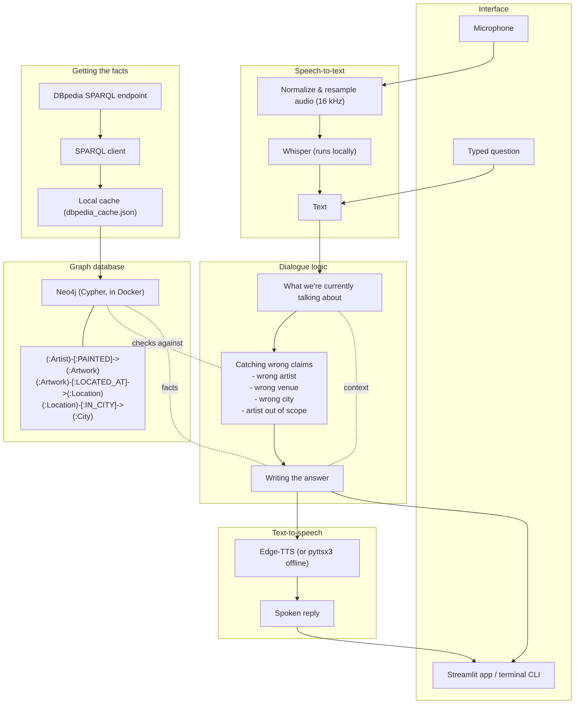

# Neapolitan Artistic Heritage Speech Dialogue System
### Caravaggio & Battistello Caracciolo in Naples, Italy

A speech chatbot that answers questions about works by **Caravaggio** and **Battistello Caracciolo** that you can actually go see in Naples. You can talk to it or type, and it talks back.

The knowledge it answers from comes from **SPARQL queries on DBpedia**, loaded into a **Neo4j graph database**. It also tries to catch when a question gets something wrong — wrong artist, wrong museum, wrong city — and corrects it instead of just answering along, and it remembers what you were just talking about across a few turns.

---

## How it fits together

Voice or text comes in, gets turned into a graph lookup, checked for mistakes, and answered out loud:



---

## What it actually does

### 1. Pulls its own data from DBpedia
- Queries the public DBpedia SPARQL endpoint directly — nothing is hand-copied from Wikipedia.
- Gets artwork details, artist background, and museum info this way.
- All of it goes into Neo4j, which is the only place the chatbot reads from (no local fallback database).

### 2. Catches wrong claims instead of just going along with them
It checks what you say against the graph and pushes back if something's off:
- **Wrong artist:** e.g. saying Battistello painted *The Seven Works of Mercy* (that's Caravaggio's).
- **Wrong museum:** e.g. saying *The Seven Works of Mercy* is at Capodimonte instead of Pio Monte della Misericordia.
- **Wrong city:** asking about Caravaggio's Roman or Florentine works as if they were in Naples.
- **Out-of-scope artists:** politely says it only covers Caravaggio and Battistello, not Leonardo, Raphael, Picasso, etc.

### 3. Remembers what you were just talking about
If you say "who painted it?" or "where is it?" right after asking about a specific painting, it knows what "it" means — no need to repeat the title every time.

### 4. Speaks and listens
- **Speech-to-text:** OpenAI Whisper (`medium` model), running locally, no API key needed. The technical report covers how I tuned it on my own accented voice, and a comparison against Groq's free hosted Whisper API.
- **Text-to-speech:** Edge-TTS, with an offline `pyttsx3` fallback if that's unavailable.

---

## The catalog

### Caravaggio in Naples
| Artwork | Year | Where | Medium |
|---|:---:|---|---|
| **The Seven Works of Mercy** | 1607 | Pio Monte della Misericordia (Via dei Tribunali 253) | Oil on canvas |
| **The Flagellation of Christ** | 1607 | Museo Nazionale di Capodimonte (Via Miano 2) | Oil on canvas |
| **The Martyrdom of Saint Ursula** | 1610 | Gallerie d'Italia, Palazzo Zevallos (Via Toledo 185) | Oil on canvas |

### Battistello Caracciolo in Naples
| Artwork | Year | Where | Medium |
|---|:---:|---|---|
| **The Liberation of Saint Peter** | 1615 | Pio Monte della Misericordia (Via dei Tribunali 253) | Oil on canvas |
| **The Washing of the Feet** | 1622 | Certosa di San Martino (Largo San Martino 5) | Oil on canvas |
| **Christ at the Column** | 1625 | Museo Nazionale di Capodimonte (Via Miano 2) | Oil on canvas |
| **Trinitas Terrestris** | 1617 | Chiesa della Pietà dei Turchini (Via Medina 19) | Oil on canvas |
| **Frescoes of the Chapel of the Assunta** | 1631 | Certosa di San Martino (Largo San Martino 5) | Fresco cycle |

---

## Running it

### You'll need
- Python 3.10+
- Docker, with a Neo4j container called `neo4j-nlp` (create it once with
  `docker run -d --name neo4j-nlp -p 7474:7474 -p 7687:7687 -e NEO4J_AUTH=neo4j/password neo4j:latest`).
  There's no fallback — the app won't start without Neo4j reachable at `bolt://localhost:7687`.
- A virtual environment:
```bash
python3 -m venv .venv
source .venv/bin/activate
pip install -r requirements.txt
```

### Fastest way: one command
```bash
./run.sh
```
This starts the `neo4j-nlp` container if it's not already running, waits for it to be ready, then launches the app.

### Doing it step by step instead

Build the graph (pulls from DBpedia and loads Neo4j):
```bash
docker start neo4j-nlp   # if it's not already running
.venv/bin/python scripts/build_graph.py
```

Launch the web app:
```bash
.venv/bin/streamlit run app.py --server.port 8502
```
Then open `http://localhost:8502`.

Or use the terminal instead of the browser:
```bash
.venv/bin/python scripts/interactive_cli.py
```

Run the tests:
```bash
.venv/bin/pytest tests/
.venv/bin/python tests/stress_test_150.py   # 150-case stress benchmark
```

---

## Where everything is

```
NLP-Project/
├── app.py                         # The Streamlit app
├── run.sh                         # One-command launch (starts Neo4j if needed)
├── TECHNICAL_REPORT.pdf           # The project report
├── presentation.pptx              # Slide deck
├── requirements.txt
├── config/
│   └── settings.py                # SPARQL, Neo4j, ASR, TTS settings
├── docs/
│   └── pipeline_architecture.png  # Diagram used in the report
├── src/
│   ├── data_pipeline/
│   │   ├── curated_dataset.py     # The artworks/artists/venues this project covers
│   │   ├── sparql_client.py       # Talks to DBpedia
│   │   └── graph_db.py            # Talks to Neo4j
│   ├── dialogue/
│   │   ├── inconsistency.py       # Catches wrong claims
│   │   ├── state_tracker.py       # Remembers what we're talking about
│   │   └── chatbot.py             # Puts it all together into a reply
│   ├── speech/
│   │   ├── asr.py                 # Whisper speech-to-text
│   │   ├── tts.py                 # Edge-TTS / pyttsx3 text-to-speech
│   │   └── speech_chatbot.py      # Glues ASR + chatbot + TTS together
│   └── utils/
│       └── audio_utils.py         # Audio loading, resampling, normalizing
├── scripts/
│   ├── build_graph.py             # Loads DBpedia data into Neo4j
│   ├── interactive_cli.py         # Chat from the terminal
│   ├── tune_asr_hyperparams.py    # Whisper hyperparameter sweep on real recordings
│   ├── benchmark_asr_models.py    # Whisper model-size comparison
│   ├── benchmark_groq_vs_local.py # Local Whisper vs. Groq's free cloud Whisper API
│   └── accent_calibration_panel.py # A small Streamlit tool for recording test sentences
├── tests/
│   ├── conftest.py
│   ├── test_dialogue.py           # Multi-turn conversation & pronoun resolution
│   ├── test_inconsistency.py      # Every inconsistency type
│   ├── test_asr.py                # Word Error Rate tests
│   └── stress_test_150.py         # 150-case stress benchmark
└── data/
    ├── dbpedia_cache.json         # Cached DBpedia results
    ├── accent_test_samples/       # 10 recordings of my own voice, used for ASR tuning
    └── stress_test_report_150.json
```

Neo4j isn't a file here — it's a Docker container (`neo4j-nlp`), see **Running it** above.
