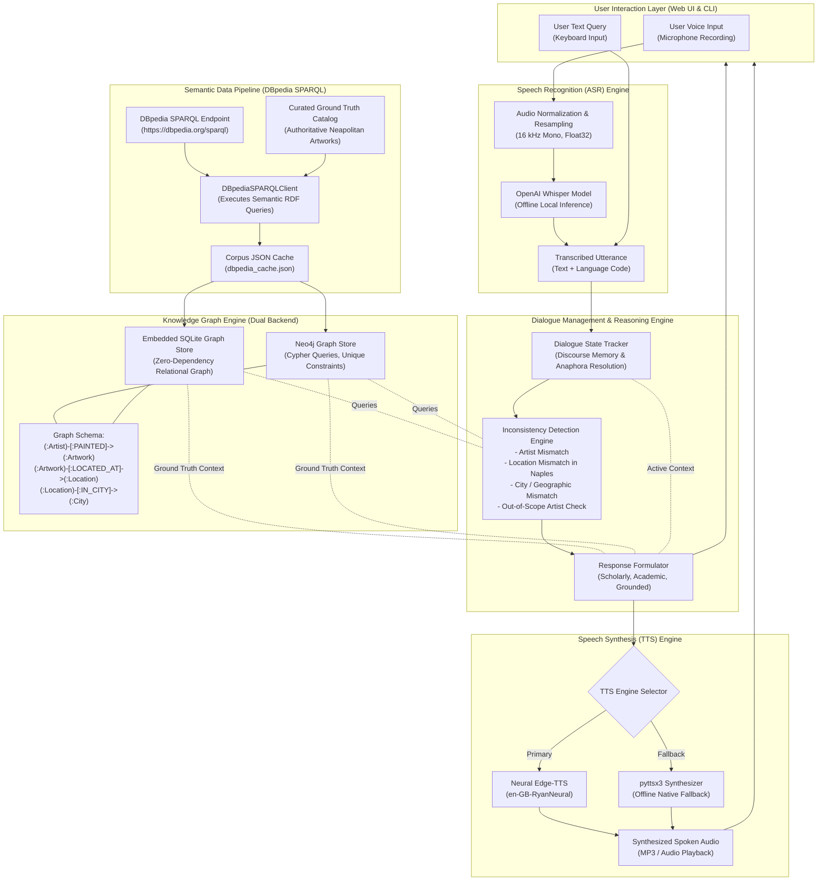

# End-to-End System Pipeline Architecture
## Neapolitan Artistic Heritage Speech Dialogue System

The system operates as an integrated multimodal pipeline connecting semantic web data acquisition (SPARQL/DBpedia), graph database modeling (Neo4j / SQLite), inconsistency detection, dialogue state tracking, automatic speech recognition (ASR), and speech synthesis (TTS).

---

## 1. Complete Pipeline Graph (Mermaid Diagram)

---

## 2. Pipeline Stage Breakdown

### Stage 1: Data Ingestion & Graph Modeling
- **SPARQL Endpoint Queries:** Dynamic retrieval of RDF triples from DBpedia for Caravaggio and Battistello Caracciolo.
- **Entity Merging:** Enriches museum locations (*Pio Monte della Misericordia*, *Museo Nazionale di Capodimonte*, *Gallerie d'Italia Palazzo Zevallos*, *Certosa di San Martino*, *Chiesa della Pietà dei Turchini*) with physical addresses, coordinates, and verified historical metadata.
- **Dual Graph Store:**
  - **Neo4j:** Production-grade graph database queried via Cypher.
  - **Local SQLite Graph Store:** Embedded zero-setup fallback executing matching relational graph traversals.

### Stage 2: Spoken Input Processing (ASR)
- **Audio Preprocessing:** Ingests microphone buffers, resamples audio to 16,000 Hz single-channel float32, and handles format headers.
- **Whisper ASR Inference:** Transcribes voice inquiries locally on device without external API calls or latency overhead.

### Stage 3: Discourse State Tracking & Coreference
- Maintains structured dialogue state:
  - `active_artist`: e.g., Caravaggio or Battistello Caracciolo.
  - `active_artwork`: Current painting under discussion.
  - `active_location`: Physical venue in Naples.
  - `turn_counter`: Chronological exchange counter.
- **Anaphora Resolution:** Uses regex word-boundary patterns to resolve pronouns (`it`, `its dimensions`, `who painted it?`, `where is it located?`, `what else is there?`) to active discourse entities.

### Stage 4: Inconsistency & Contradiction Detection
Validates every user utterance against graph facts before answering:
1. **Artist Attribution Mismatch:** Identifies when an artwork by Caravaggio is falsely attributed to Battistello or vice-versa.
2. **Location Mismatch within Naples:** Catches inquiries placing works at the wrong Neapolitan institution (e.g., *The Seven Works of Mercy* at Capodimonte instead of Pio Monte).
3. **Geographic / City Mismatch:** Flags requests for masterworks permanently housed in Rome (*The Calling of Saint Matthew*), Florence (*Bacchus*), Paris (*Death of the Virgin*), or Malta (*The Beheading of Saint John the Baptist*).
4. **Out-of-Scope Artists:** Polite boundary enforcement when non-cataloged figures (e.g., Leonardo da Vinci, Raphael, Picasso) are asked about.

### Stage 5: Response Generation & Spoken Synthesis (TTS)
- Constructs clear, objective, scholarly responses formatted in humanized English.
- Synthesizes speech using high-fidelity neural voices with offline local fallback.
